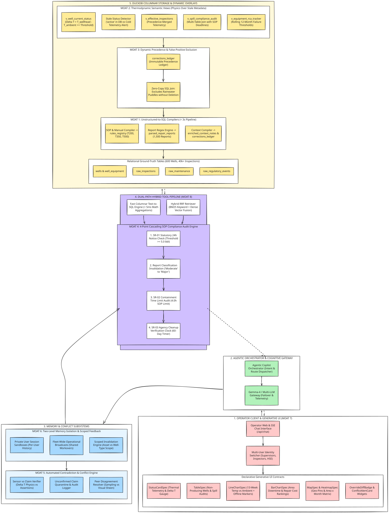

# FlytBase Asset Intelligence Copilot

An enterprise agentic AI copilot engineered for industrial oilfield operations across 600 production wells and 125,000+ inspection records. Combines a dual-role **Gemma 4** cognitive gateway with an in-memory **DuckDB** semantic layer and declarative **Generative UI contracts**.

[](https://opensource.org/licenses/MIT)
[-purple.svg)](https://ai.google.dev/gemma)
[](https://duckdb.org/)
[](https://nextjs.org/)
[](https://www.digitalocean.com/)

---

## Overview

In upstream oil and gas operations, relying on raw LLM SQL generation is dangerous: models hallucinate arithmetic, misinterpret thermodynamic thresholds, and lack forensic auditability.

**Asset Intelligence Copilot** is designed around a fundamental engineering principle: **The Dual Epistemic Split**.
- **Deterministic Record of Reference:** All operational metrics, downtime states, and thermodynamic evaluations ($\Delta T = T_{\text{wellhead}} - T_{\text{ambient}}$) are computed exclusively via vectorized DuckDB SQL views over domain rules.
- **Cognitive Gateway:** An open-weight **Gemma 4** model architecture interprets user intent, orchestrates multi-step tool calls, arbitrates physical discrepancies, and emits structured Generative UI contracts.

---

## System Architecture



---

## Core Technical Components

### 1. Dual-Role Gemma 4 Cognitive Gateway (`backend/llm/gemma_gateway.py`)
- **Fast Router (`gemma-4-26b-a4b-it`):** Sub-second intent extraction, entity resolution (wells, operational areas, time horizons), and declarative Generative UI contract typing.
- **Deep Reasoner (`gemma-4-31b-it`):** Multi-step tool orchestration and regulatory compliance reasoning (OPS-1 gas odor response deadlines, OPS-2 flowline bypass authorizations, and OPS-3 status arbitration).
- **Fault-Tolerant Failover Chain:** Seamless fallback across Google AI Studio, OpenRouter, and self-hosted Ollama endpoints.
- **Telemetry Logger:** Automatically records prompt tokens, completion tokens, latency, cost, and provider metadata into an immutable DuckDB telemetry table.

### 2. In-Memory DuckDB Analytical Engine (`backend/db/`)
- **Zero-Cost Semantic Overlays:** Evaluates thermodynamic operating rules on the fly:
  - T200 Wells: $\Delta T \ge 15.0^\circ\text{C}$
  - T350 Wells: $\Delta T \ge 20.0^\circ\text{C}$
  - T500 Wells: $\Delta T \ge 25.0^\circ\text{C}$
- **Bitemporal Audit Ledger:** Separates *Valid Time* (when an operational event physically occurred) from *Recorded Time* (when the system learned of it), ensuring tamper-proof audit trails.
- **Sub-15ms Aggregations:** Aggregates multi-year fleet data across 125,198 inspection rows in under 15 milliseconds.

### 3. Dual Data Hybrid-Tool Pipeline (`backend/agent/tools.py`)
- **Fast Columnar SQL:** Directly queries structured tables for counts, equipment rankings, and spatial aggregations.
- **Hybrid Semantic Retrieval:** Pairs BM25 lexical keyword matching with dense vector embeddings via Reciprocal Rank Fusion (RRF) over unstructured maintenance work orders and SOP manuals.

### 4. Memory & Conflict Arbitration (`backend/memory/`, `backend/conflicts/`)
- **Two-Level Scoped Memory:** Sandboxes private operator scratchpads while broadcasting verified operational overrides fleet-wide with role-based access control.
- **Automated Contradiction Engine:** Actively cross-verifies operator sensor claims against physical inspection notes (e.g. detecting physical pump stoppage notes when a user claims high wellhead temperature).
- **Hardened Write Path:** Enforces `Propose ➔ Diff ➔ Confirm ➔ Commit` with typed `OverrideDiffBadge` visual confirmations.

### 5. Declarative Generative UI Contracts (`frontend/src/`)
- Built with **Next.js 15 App Router**, **Tailwind CSS**, and **Chart.js**.
- Emits typed JSON contracts that render directly into interactive widgets:
  - `StatusCardWidget`: Real-time well status, thermodynamic telemetry, and stale-record alerts.
  - `LineChartWidget`: Multi-week thermal telemetry with explicit operating threshold markers and downtime flags.
  - `HeatmapWidget`: 2D multi-area monthly incident matrices with instant grand totals.
  - `ConflictAlertWidget`: Side-by-side reconciliation between physical field notes and sensor telemetry.

---

## Benchmark Evaluations

The system has been evaluated deterministically across the 600-well operational test dataset (`today = 2027-01-15`):

| Question / Benchmark Topic | Key Technical Finding | Output Component |
| :--- | :--- | :--- |
| **Q1: Reservoir Pressure Mapping** | Correctly identifies no downhole/casing pressure sensors exist; refuses to hallucinate data. | Refusal & Recommendation |
| **Q2: Best Oil Producer in 2026** | Identifies volume is unmetered; proves 412 wells had 100% uptime without guessing barrels. | Epistemic Synthesis |
| **Q3: OPS-1 Gas Odor Compliance** | Audited 26 field-wide reports: 17 met deadlines, 9 missed across 24h/12h cutoffs. | Audit Table with Hours |
| **Q4: OPS-2 Flowline Bypasses** | Identified 3 active bypasses (1 allowed under MOC-044, 1 expired, 1 unapproved). | Compliance Status Matrix |
| **Q5: State Regulatory Spill Letter** | Screened reportable spills ($\ge 5.0$ bbl); audited required laboratory verification text. | Regulatory Compliance Table |
| **Q6: OPS-3 Status Disagreements** | Resolved 5 wells where operator notes and telemetry disagreed based on note recency. | Arbitration Status Table |
| **Q7: 90-Day Equipment Failure Ranking** | Ranked Top-10 failure risks using operator note quotes; recommended Top-3 crew dispatches. | Prioritized Dispatch Table |
| **Q8: Multi-Session Scoped Memory** | Handled 5 turns across 4 distinct operators; preserved private preferences without leakage. | Scoped Provenance Ledger |
| **Q9: Multi-Topic Operations Triage** | Handled 6 concurrent operational topics including recalled Highline RP-175 pumps. | Multi-Section Synthesis |
| **Q10: 2026 Shut-in Delay Breakdown** | Revealed delays are 66.7% Weather and 33.3% Parts; Southeast Block 32 is a 35-day outlier. | Stacked Bar Chart & Table |
| **Q11: Thermal Field Distribution** | Proved Southeast region runs hottest (Mean 51.24°C; Southeast Block 31 at 52.85°C). | Statistical Distribution |

*Detailed benchmark methodology, exact formulas, and outputs are documented in [`docs/REPORT.md`](docs/REPORT.md).*

---

## Deployment & Cloud Configuration

The project is fully pre-configured for containerized cloud deployment on **DigitalOcean**:

### 1. DigitalOcean App Platform (Web Console Deployment)
The fastest way to deploy with zero infrastructure management and automated SSL/TLS certificates:
1. Log in to the **[DigitalOcean Cloud Console](https://cloud.digitalocean.com/apps)** and click **Create App**.
2. Select **GitHub** as the source provider:
   - Repository: `ashum9/AssetIntelligenceCopilot`
   - Branch: `master`
   - Source Directory: `/`
3. **Build & Runtime Settings**:
   - DigitalOcean automatically detects the production [`Dockerfile`](Dockerfile) and [`.do/app.yaml`](.do/app.yaml) specification.
   - HTTP Port: `8080`
   - Health Check Probe: `/api/health` (Initial delay: 15s, Period: 15s, Timeout: 5s)
4. **Environment Variables**:
   - `PORT`: `8080`
   - `REFERENCE_TODAY`: `2026-10-17`
   - `DATASET_ROOT`: `/app/sample-data`
   - `ARTIFACTS_DIR`: `/app/artifacts`
   - `GEMINI_API_KEY`: *(Optional)* Your Google AI Studio API key for Gemma 4 cloud inference (if omitted, the copilot executes via deterministic fallback).
5. **Instance Sizing**: Choose **Basic** (512MB RAM or 1GB RAM) and click **Create Resources**.
6. The container pre-compiles the DuckDB engine during image build (~3s) and deploys behind DigitalOcean's global CDN ingress.

### 2. DigitalOcean App Platform via CLI (`doctl`)
Deploy or update the app directly from your terminal using `doctl`:
```bash
# 1. Authenticate doctl with your DigitalOcean Personal Access Token
doctl auth init

# 2. Deploy using the App Platform specification
./deploy/deploy_digitalocean.sh
# or directly via:
doctl apps create --spec .do/app.yaml

# 3. Stream real-time container build and runtime logs
doctl apps logs <app-id> --follow
```

### 3. DigitalOcean Spaces Storage (S3-Compatible)
Integrated for persistent off-site backups of the bitemporal corrections ledger and telemetry logs:
- **Endpoint:** `https://nyc3.digitaloceanspaces.com`
- **Bucket:** `flytbase-asset-intelligence`
- **Configuration:** Set `DO_SPACES_KEY` and `DO_SPACES_SECRET` in `.env` or App Platform environment settings.

### 4. Local Container Deployment (Docker Compose)
To test container parity locally before deploying:
```bash
# Build and run the production image on port 8080
docker compose up --build

# Verify container health check probe
curl http://localhost:8080/api/health
```

### 5. Production Endpoints
Once deployed to DigitalOcean, your app provides:
- **Interactive Web Dashboard:** `https://<your-app-slug>.ondigitalocean.app/`
- **Interactive Swagger UI:** `https://<your-app-slug>.ondigitalocean.app/docs`
- **Alternative ReDoc UI:** `https://<your-app-slug>.ondigitalocean.app/redoc`
- **Zero-Downtime Health Probe:** `https://<your-app-slug>.ondigitalocean.app/api/health`

---

## Quickstart & Installation

### Prerequisites
- Python 3.11+
- Node.js 18+ and npm
- DuckDB 1.2+

### 1. Backend Setup
```bash
git clone https://github.com/ashum9/AssetIntelligenceCopilot.git
cd AssetIntelligenceCopilot

# Create virtual environment
python3 -m venv venv
source venv/bin/activate
pip install -r requirements.txt

# Compile dataset into DuckDB (~9.8s for 125k records)
python3 scripts/run_ingestion.py

# Launch FastAPI server
python3 -m uvicorn backend.api.main:app --host 0.0.0.0 --port 8000
```

### 2. Frontend Setup
```bash
cd frontend
npm install
npm run build
npm start -p 3000
```
Open **[http://localhost:3000](http://localhost:3000)** in your browser!

---

## License

This project is licensed under the [MIT License](LICENSE).
